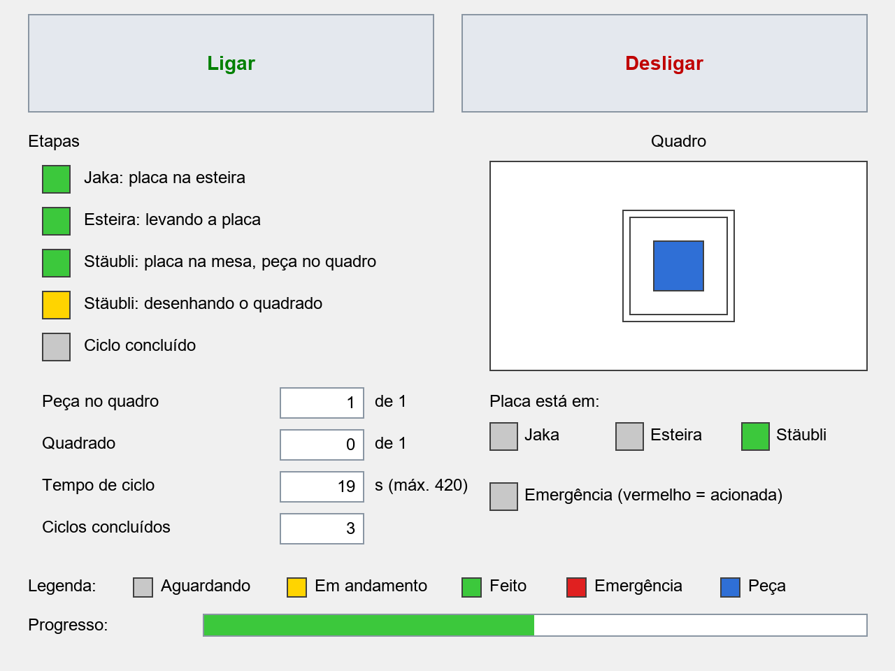

# PLC program

Automation Studio project: `plc/ProjetoFinalRobotica/ProjetoFinalRobotica.apj`
(Automation Studio 4.1.14, based on the course "ProjetoPadraoIHM" template).

## Where this project comes from

Compared file by file with the template the professor handed out
(`ProjetoFinalRobotica`, without the `plc/` copy's changes):

| | Professor's template | This project |
|---|---|---|
| Hardware (4PP481 + X20 modules, AR E3.10, IP `192.168.0.70`) | Yes | Same (only the panel's hardware description version differs, 1.1.0.0 vs 1.0.0.0) |
| Program | **None** (`Cpu.sw` has no task) | `NewProgram` with the sequence below |
| I/O mapping | Leftover entries for a program `Robos` that is not in the project, with an older wiring that does **not** match Table I | Matches Table I |
| HMI | B&R coffee-machine sample pages only | Adds `Init_Page` (start button, step lamps, counters, whiteboard, plate position) |
| Shared files | | 381 of the template's Logical files are identical |

So this project was built from the professor's template: it keeps the
template's hardware and libraries and adds the program, the I/O map and the
HMI page. It also contains `ProjetoPadrao.zip`, a snapshot from 29/05/2026
where `NewProgram` only had a conveyor test (`esteira1`, `esteira2`).

Starting from this project gives everything the template has plus a working
I/O map. If the template is used instead, its `IoMap.iom` must be cleaned
first, because the `Robos` entries point to a program that does not exist.

## Target configuration

| Item | Value | Where |
|---|---|---|
| CPU | 4PP481.1043-B5 | `Physical/Config1/Hardware.hw` |
| Automation Runtime | E3.10 (stored in the project, `AS/System/E0310`) | `Physical/Config1/4PP481_1043_B5/Cpu.pkg` |
| Ethernet IF5 | `192.168.0.70`, manual, no gateway, no DNS | `Hardware.hw` |
| Online connection | TCP/IP to `192.168.0.70`, port 11169 | `Cpu.pkg` |
| Task | `NewProgram`, Cyclic#1 (10 ms) | `Cpu.sw` |
| HMI | Visual Components object `Visu` (page `Init_Page`) | `Logical/Visualisation` |

> The handout says the Jaka robot is also at `192.168.0.70`. Two devices on the
> same network cannot share an IP, so one of the two values is wrong. Confirm
> on the cell.

## I/O mapping

All I/O variables are local to `NewProgram` and mapped in `IoMap.iom`. The
mapping matches Table I of the handout. Meanings are those of the whiteboard
application ([whiteboard-application.md](whiteboard-application.md)).

| Variable | Address | Meaning |
|---|---|---|
| `Jaka_DO7` | DI9371 ch 1 | DONE: plate on the conveyor |
| `Jaka_DO6` | DI9371 ch 2 | Spare |
| `Jaka_DO5` | DI9371 ch 3 | Pulse: plate gripped (used by the twin only) |
| `Staubli_DO4` | DI9371 ch 5 | DONE: plate on the table, part on the board |
| `Staubli_DO5` | DI9371 ch 6 | DONE: square drawn, marker stored |
| `Staubli_DO6` | DI9371 ch 7 | Pulse: one part placed |
| `Staubli_DO7` | DI9371 ch 8 | Pulse: one square drawn |
| `Sensor_Staubli` | DI9371 ch 9 | Plate at the Stäubli end of the conveyor |
| `Sensor_Jaka` | DI9371 ch 10 | Plate at the Jaka end of the conveyor |
| `Emergencia` | DI9371 ch 12 | TRUE = safe |
| `Jaka_DI3` | DO9322 ch 1 | CMD: put the plate on the conveyor |
| `Jaka_DI2` | DO9322 ch 2 | 1 s pulse at the start of the cycle (cleared early on `Jaka_DO7`) |
| `Jaka_DI1` | DO9322 ch 3 | Spare |
| `Staubli_DI12` | DO9322 ch 5 | CMD: plate to the table, part to the board (1 s pulse at the start of step 2) |
| `Staubli_DI13` | DO9322 ch 6 | 1 s pulse at the start of the cycle |
| `Staubli_DI14` | DO9322 ch 7 | CMD: pick the marker, draw, put it back |
| `Staubli_DI15` | DO9322 ch 8 | Spare |
| `Esteira_StaubliJaka` | DO9322 ch 11 | Spare (always FALSE) |
| `Esteira_JakaStaubli` | DO9322 ch 12 | Carries the plate to the Stäubli |

## Sequence

Sequence as run on the lab panel. The robots get start pulses instead of
the full four-phase handshake: `Jaka_DI2` and `Staubli_DI13` are 1 s pulses
at the start of the cycle (timer `TmrPulso`), `Staubli_DI12` is a 1 s pulse
at the start of step 2 (timer `TmrDI12`), and `Jaka_DI3` stays TRUE for the
whole cycle. The robots still clear their DONE outputs themselves, and the
PLC waits for that before moving on.

`LIGA_JAKA` is TRUE while a cycle runs (`Ligar AND Emergencia`).
`TwinSender` sends it in the `Jaka_DI2` byte, so the digital twin sees
"cycle running" there rather than the 1 s pulse.

| `Etapa` | Does | Next when |
|---|---|---|
| 0 | Idle. On start: reset flags and counters, set `Jaka_DI3` | `Ligar AND Emergencia` |
| 1 | On `Jaka_DO7`: start the conveyor (and end the `Jaka_DI2` pulse). Conveyor `AND Sensor_Staubli` → stop it | Plate arrived and `Jaka_DO7` cleared |
| 2 | 1 s `Staubli_DI12` pulse; on `Staubli_DO4` clear it | `Staubli_DO4` |
| 3 | Wait for the Stäubli to clear DONE | `Staubli_DO4` cleared |
| 4 | Set `Staubli_DI14`; on `Staubli_DO5` clear it | `Staubli_DO5` |
| 5 | Count the cycle, clear `Ligar` | `Staubli_DO5` cleared → 0 |

- One run per start: `Ligar` is cleared at the end of the cycle, so the
  operator presses **Ligar** again for the next run (after putting the plate
  with the part back at the Jaka and taking the part off the board).
- `NUM_PECAS` (constant in `NewProgram.var`, 1 for now) is the number of
  parts per run: the counters stop at it and jump to it on the DONE signals.
- E-stop: every command, enable, `LIGA_JAKA` and conveyor goes FALSE and
  `Etapa` returns to 0. It also clears `Ligar`, so releasing it never
  restarts the cell by itself. The HMI state (lamps, counters, cycle time)
  resets too, unless the cycle had finished (`CicloConcluido`), which stays
  on screen until the next start.
- The HMI has no stop button any more (**Desligar** was removed).
- `Staubli_DO6` / `Staubli_DO7` pulses advance the HMI counters. If the
  Stäubli program does not pulse them, the counters jump to 2 when the
  matching DONE arrives.
- `TwinSender;` stays the last line of `_CYCLIC`.

This is the program compiled and run on the lab panel, with the `AsUDP`
library added for `TwinSender`.

## HMI (`Init_Page`)

*Preview drawn from an earlier version of the page file with sample values,
not a screenshot of the panel. The page on the panel no longer has the
Desligar button or the progress bar, and the cycle time shows only seconds.*

| Element | Variable |
|---|---|
| Ligar | `Ligar` (set to 1) |
| Step lamps: Jaka (plate on the conveyor), conveyor, Stäubli part, drawing, cycle done | `iCorJaka`, `iCorEsteira`, `iCorPecas`, `iCorDesenho`, `iCorConcluido` |
| Part on the board, square, cycle time (s), completed cycles | `iPecasNoQuadro`, `iQuadrados`, `iTempoCiclo_s`, `iContador` |
| Whiteboard: the part and its square light up | `iCorPeca`, `iCorQuadrado` |
| Plate position: Jaka / conveyor / Stäubli | `iCorPlacaJaka`, `iCorPlacaEsteira`, `iCorPlacaStaubli` (from `iPlaca`) |
| E-stop lamp | `iCorEmergencia` |
| Color legend (bottom row) | Fixed swatches: waiting, running, done, E-stop, part |

Lamp colors are palette indexes computed in the PLC, the same technique the
previous page used: grey 250 = waiting, yellow 46 = running, green 155 =
done, red 51 = E-stop. The page only uses control types that already existed
in the project (button, text, shape, bar graph) plus the numeric output of
the B&R sample. After the first build, adjust positions and fonts in the
Automation Studio page editor as needed; from then on edit the page there.

The page's texts live in its embedded text group. Each `<Text ID>` needs an
entry in the group's `<IndexMap>` (ID → index); the buttons (`TextIndex`)
and text controls (`TextIndexOffset`) refer to that index. Without the
`IndexMap` every button and label on the panel is blank, which is what
happened after the page was first rewritten. Here index = ID − 94979.

## Previous application (Renan's)

The project received from Renan built a 6-part pyramid:

- `Etapa` 0 → 1 → 2: the Jaka puts a part on the conveyor, the conveyor
  carries it, the Stäubli picks it and stacks it.
- `iContador` went up twice per part on purpose (odd: Jaka placed part n,
  even: Stäubli picked part n). The HMI showed a 6 × 2 table (Jaka/Stäubli
  per part) and a 3-2-1 pyramid lit by the even steps.
- Two problems it had, both solved by the new sequence: the 1 s pulse on
  `Staubli_DI12` stopped working after the first part (the timer input was
  never cleared), and the stop branch set `Staubli_DI12`, `Staubli_DI13` and
  `Jaka_DI3` to TRUE.

## Leftovers from the template

`Logical/Global.typ` still has the coffee machine types from the B&R sample
(`main_typ`, `brewing_typ`, ...), and `Logical/Visu` holds the sample pages.
They are not used by `NewProgram`.

## Files kept out of git

The repository is public, so some files stay out of git:

| Path | Why |
|---|---|
| `Temp/`, `Binaries/`, `Diagnosis/` | Regenerated by every Automation Studio build |
| `ProjetoPadrao.zip` | Original course template (56 MB), available on Teams |
| `*.set` | Per-user Automation Studio settings, named after classmates |
| `AS/` | B&R Automation Runtime E3.10 binaries (proprietary, 32 MB) |

The project is set to `StoreRuntimeInProject`, so a fresh clone is missing
`AS/System/E0310`. Before building on a new machine, copy `AS/` from the
original project on the lab PC, or install AR E3.10 in Automation Studio
(lab PCs that already build the cell projects should have it).
